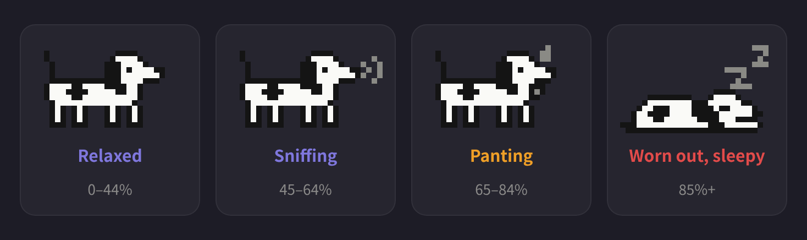
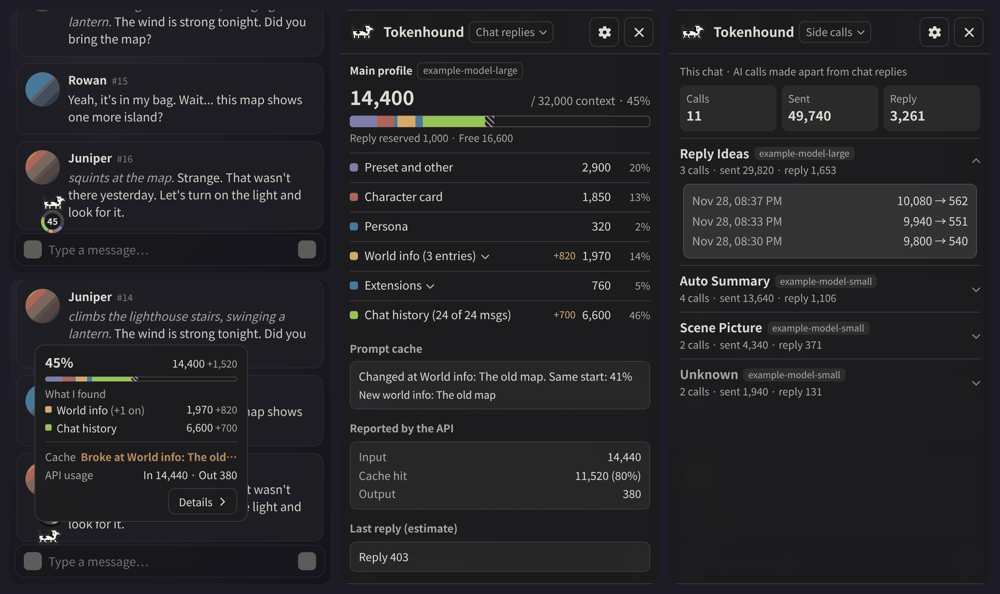
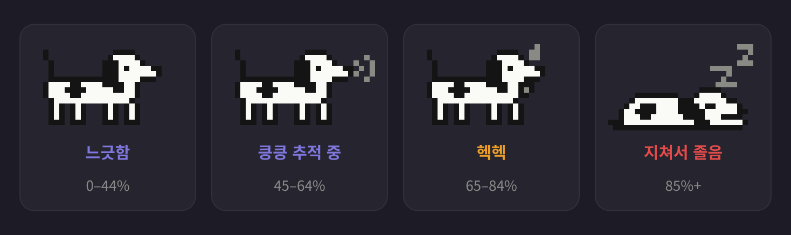
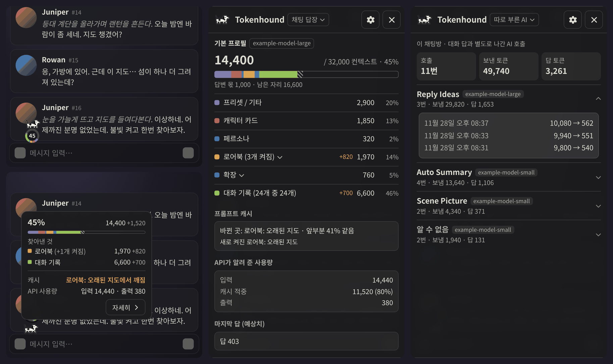

# Tokenhound

A SillyTavern extension that sniffs out where your prompt tokens go.

[한국어 설명은 아래에 있어요](#한국어)

Tokenhound shows how much of the context each part of the prompt used: preset, character card, persona, world info, extensions, and chat history. A small black-and-white pixel hound keeps you company on screen. It gets more tired as the context fills up.

Example screens with a made-up chat. Your screen may look a little different.

## Features

- **Choose how it shows on screen**: a hound that wanders along the input box (default), a hound resting by its doghouse on the edge of the input (drag it left or right), a small button you can drag anywhere, or nothing at all (open it from the wand menu). You can also turn on a bar above the input, alone or together with the others. The bar shows each part in its own color. The small button can show a tiny bar under the hound, a ring around it, or just the number. The wandering hound can also play with the ring (off by default): roll it along with its nose, or ride on top of it. The number then stays on the ring instead of popping up after each reply. The resting hound peeks out, lies down, and dozes off; a reply wakes it up. It shows the number on a nameplate (with a pop-up after each reply) or on a donut pillow. Turn off "Walk outside chats too" to hide the hound when no chat is open.
- **Quick card**: tap the hound or the button to see what changed since the last turn: the total, the parts that changed most, the cache, and the API usage. Tap **Details** for the full window. You can make a tap open the full window right away instead. Tapping the bar above the input also opens the quick card by default, or the full window if you choose.
- **Breakdown**: tokens and percent for each part of the prompt. Shows the change from the last turn.
- **World info and extensions**: tap to see each world info entry and each extension prompt.
- **Chat history**: how many messages fit, and how many older ones were left out. Hidden messages aren't sent to the AI, so they aren't counted.
- **Prompt cache hints**: where the prompt first changed since the last turn, for example "new world info entry" or "older messages scrolled out".
- **Usage reported by the API**: input, cache hit, output, and thinking tokens, when your API reports them.
- **Reply size**: estimated tokens of the last reply and its thinking part.
- **Biggest items**, a **trend line**, and a **tracking log** for each chat (a token record left each time you send a message).
- **Show estimate**: count the next prompt without sending it. Press "Back to normal" to return to the last turn.
- **Current model and connection profile**. Extension names come from your installed extensions when they can be matched.
- **Theme**: auto (follows your SillyTavern theme), light, or dark.
- English and Korean. By default it follows your SillyTavern language.

The hound has four moods: relaxed, sniffing, panting, and sleepy. You can change the steps (default 45 / 65 / 85%) in the settings.

## Install

1. In SillyTavern, open **Extensions** › **Install extension**.
2. Paste `https://github.com/Near7707/Tokenhound` and install.

Settings are in **Extensions › Tokenhound**. The ⚙ button in the window has quick settings.

## How it counts

- Counts come from SillyTavern's tokenizer, so they are **estimates**. Your model may count a little differently. The "Reported by the API" box shows the real numbers when your API sends them.
- Tokenhound finds each part by looking for its text in the final prompt. "Preset and other" is what's left: system prompts, formatting, and anything it couldn't match.
- Regex scripts or macros that change text only in the prompt can make some parts land in "Preset and other".
- SillyTavern doesn't report world info during a dry run. "Show estimate" reuses the entries from the last real turn and doesn't include the message you're typing.
- The usage box depends on your API. Some APIs don't send usage when streaming.
- With Google Gemini (AI Studio or Vertex AI), usage shows only when streaming is on. With streaming off, SillyTavern doesn't pass the usage on.

## Safety

- Read-only. Tokenhound doesn't add anything to the prompt, and it doesn't change chats, cards, or other extensions' settings.
- To read the API usage, it reads a copy of the reply your API sends back to SillyTavern. Nothing is sent anywhere. You can turn this off in the settings.
- The tracking log stores numbers, entry names, and the model name, not your messages. It keeps up to 100 chats.
- By default the log is also saved as small files in your SillyTavern user files (the same folder as Data Bank uploads), so your PC and phone see the same log. Chat files are not touched. Turn off "Share the tracking log between devices" to keep it in this browser only.
- SillyTavern's Data Maid may list these files (`tokenhound-….json`) as unused. Deleting them only removes the log.

## Group chats

Group chats are supported. The card row shows the name of the character who is speaking.

---

## 한국어

실리태번 프롬프트에서 토큰이 어디에 얼마나 들어갔는지 찾아 주는 확장이에요.

프리셋, 캐릭터 카드, 페르소나, 로어북, 확장, 대화 기록이 컨텍스트를 각각 얼마나 썼는지 보여 줘요. 화면에는 흑백 도트 하운드가 함께 있고, 컨텍스트가 찰수록 점점 지쳐요.

지어낸 대화로 만든 예시 화면이에요. 실제 화면과 조금 다를 수 있어요.

### 기능

- **화면 표시 방식 고르기**: 입력칸 위를 돌아다니는 강아지(기본), 입력칸 위에서 집에 쉬는 강아지(좌우로 끌어서 옮기기), 끌어서 아무 데나 옮길 수 있는 작은 버튼, 아무것도 안 띄우기(마법봉 메뉴에서 열기) 중에 골라요. 입력칸 위 막대는 따로 켤 수 있어서 혼자 쓰거나 다른 방식과 같이 쓸 수 있어요. 막대는 항목마다 다른 색으로 나눠 보여 줘요. 작은 버튼은 하운드 밑 작은 막대, 하운드 둘레 도넛, 숫자만 중에서 모양을 고를 수 있어요. 돌아다니는 강아지에게 도넛을 줄 수도 있어요(기본은 꺼짐). 코로 굴리기나 도넛 타기를 고르면 답이 올 때 뜨는 말풍선 대신 도넛에 숫자가 늘 보여요. 집에서 쉬는 강아지는 빼꼼 내다보다가 엎드리고, 조금 지나면 잠들어요. 답이 오면 깨요. 숫자는 문패(답이 오면 말풍선도)나 도넛 베개로 보여 줘요. "채팅방 밖에서도 산책하기"를 끄면 채팅방 밖에서는 강아지가 숨어요.
- **짧은 카드**: 강아지나 버튼을 누르면 지난 턴보다 바뀐 것만 작게 보여 줘요. 전체 토큰, 많이 바뀐 항목, 캐시, API 사용량이 나와요. **자세히**를 누르면 큰 창이 열려요. 누를 때 큰 창이 바로 열리게 바꿀 수도 있어요. 입력칸 위 막대도 누르면 짧은 카드가 열리고(기본), 큰 창으로 바꿀 수도 있어요.
- **항목별 토큰**: 항목마다 토큰과 비율을 보여 주고, 지난 턴보다 얼마나 늘고 줄었는지도 보여 줘요.
- **로어북과 확장**: 누르면 로어북 항목별, 확장별로 펼쳐서 볼 수 있어요.
- **대화 기록**: 메시지가 몇 개 들어갔고, 오래된 메시지가 몇 개 빠졌는지 보여 줘요. 숨긴 메시지는 AI에게 가지 않아서 세지 않아요.
- **프롬프트 캐시 힌트**: 지난 턴과 비교해서 프롬프트가 처음 바뀐 곳을 알려 줘요. 예를 들면 "새 로어북 항목"이나 "오래된 메시지가 밀려남" 같은 거예요.
- **API가 알려 준 사용량**: API가 알려 주면 입력, 캐시 적중, 출력, 생각 토큰을 보여 줘요.
- **답 크기**: 마지막 답과 생각 부분이 몇 토큰인지 예상해서 보여 줘요.
- **큰 항목 순위**, **추세 그래프**, 채팅방별 **추적 일지**(메시지를 보낼 때마다 남는 토큰 기록)도 있어요.
- **예상치 보기**: 보내지 않고 다음 프롬프트를 세 봐요. "원래대로"를 누르면 지난 턴 화면으로 돌아가요.
- **지금 모델과 연결 프로필**을 보여 줘요. 확장 이름은 설치된 확장 이름과 맞으면 그 이름으로 보여 줘요.
- **테마**: 자동(실리태번 테마 따라가기) / 라이트 / 다크 중에 고를 수 있어요.
- 영어와 한국어를 지원해요. 처음에는 실리태번 언어 설정을 따라가요.

하운드 표정은 느긋함, 킁킁, 헥헥, 졸음 네 단계예요. 단계 기준(기본 45 / 65 / 85%)은 설정에서 바꿀 수 있어요.

### 설치

1. 실리태번에서 **확장** › **확장 설치**를 열어요.
2. `https://github.com/Near7707/Tokenhound`를 붙여 넣고 설치해요.

설정은 **확장 › Tokenhound**에 있어요. 창 안의 ⚙ 버튼에서는 자주 쓰는 설정만 빠르게 바꿀 수 있어요.

### 세는 방법

- 숫자는 실리태번 토크나이저로 센 **예상치**예요. 모델이 실제로 세는 값과 조금 다를 수 있어요. API가 사용량을 보내 주면 "API가 알려 준 사용량" 칸에 실제 숫자가 나와요.
- 최종 프롬프트에서 각 항목의 글을 찾아서 나눠요. "프리셋 / 기타"는 그러고 남은 부분이에요. 시스템 프롬프트, 서식, 그리고 어디에도 맞추지 못한 글이 여기 들어가요.
- 프롬프트에서만 글을 바꾸는 정규식이나 매크로가 있으면, 그 부분이 "프리셋 / 기타"로 들어갈 수 있어요.
- 실리태번은 예상치를 셀 때 로어북 정보를 알려 주지 않아요. 그래서 "예상치 보기"는 마지막 턴의 로어북 항목을 다시 쓰고, 지금 입력 중인 메시지는 포함하지 않아요.
- 사용량 칸은 API에 따라 달라요. 스트리밍일 때는 사용량을 보내지 않는 API도 있어요.
- 구글 제미나이(AI Studio, Vertex AI)는 스트리밍을 켰을 때만 사용량이 나와요. 스트리밍을 끄면 실리태번이 사용량을 넘겨주지 않아요.

### 안전

- 읽기만 해요. 프롬프트에 아무것도 넣지 않고, 채팅, 캐릭터 카드, 다른 확장 설정도 바꾸지 않아요.
- API 사용량을 보려고, API가 실리태번에 돌려준 답의 복사본을 읽어요. 아무 데도 보내지 않아요. 설정에서 끌 수 있어요.
- 추적 일지에는 숫자, 항목 이름, 모델 이름만 저장하고 메시지 내용은 저장하지 않아요. 채팅방 100개까지 남아요.
- 기본으로 실리태번 사용자 파일 폴더(데이터 뱅크 파일이 들어가는 곳)에도 작은 파일로 저장해요. 그래서 PC와 폰에서 같은 기록을 봐요. 채팅 파일은 건드리지 않아요. "추적 일지를 기기끼리 같이 보기"를 끄면 이 브라우저에만 저장해요.
- 실리태번 데이터 정리 도구(Data Maid)에 이 파일들(`tokenhound-….json`)이 "안 쓰는 파일"로 보일 수 있어요. 지워도 기록만 사라져요.

### 그룹 채팅

그룹 채팅도 지원해요. 캐릭터 카드 줄에는 지금 말하는 캐릭터 이름이 나와요.
